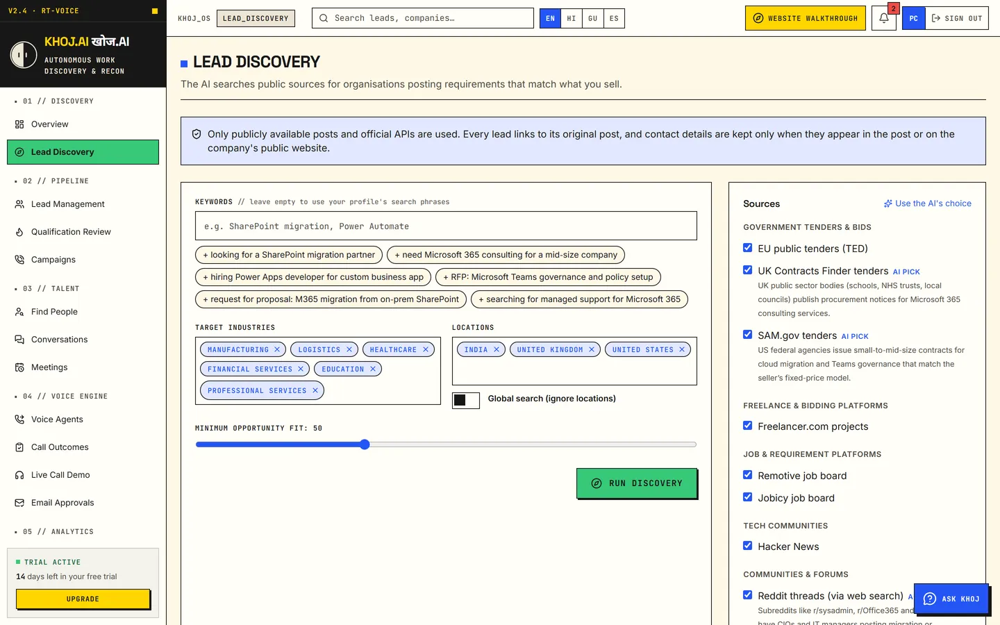

  
  
  

I build LLM apps, AI voice pipelines and the full stack products around them. I'm drawn to AI that holds up outside a demo: tool calling, structured outputs and guardrails, tuned for real-world reliability.

I'm open to internships and project work in AI/ML and full stack.

## Highlights

<picture>
  
</picture>

## Projects

### KHOJ.AI (खोज.AI)

**AI that finds real work for companies and people, calls to qualify it, and books the meeting.** *Khoj* means "search" in Hindi. I was team leader, building it with Jenil Bhisra and Mahaan Thakkar for the Chaos2Commit hackathon by Futurrizon × CHARUSAT, where we reached the Top 7 out of 45 teams.

  
  

- **For companies:** finds matching public tenders, projects and job posts, scores each one from 0 to 100 with quoted evidence, links it to the original post, and looks up missing contacts on the company's own website.
- **For freelancers and job seekers:** turns a CV into a profile and finds matching work. If they opt in, companies can talk to their personal AI agent, which answers only from that profile, and propose a meeting.
- **AI voice agent:** asks about need, budget, decision-maker and timing, holds the conversation in English, Hindi or Gujarati, and always says it's an AI. Calls end with a summary, transcript, interest score and follow-up email draft. Tested through browser calls and a live Twilio phone call.
- **Also:** an interface in English, Hindi, Gujarati and Spanish, an in-app helper called Ask KHOJ, an admin console with fraud flags and an audit log, and about 800 backend tests.

`React` `TypeScript` `FastAPI` `PostgreSQL` `Twilio` `Sarvam AI` `Groq` `Gemini` `Capacitor`

### [YieldGuard](https://github.com/Parva-28/bob-ai-hackathon-DuckDuckGo)

AI root-cause assistant for semiconductor wafer yield, built with Team DuckDuckGo. It classifies wafer-map defects with a CNN (macro-F1 of 0.9232 on a held-out split of 9,357 maps), scores sensor anomalies with an Isolation Forest, and uses watsonx.ai to rank root causes, with every hypothesis citing its evidence.

`Python` `PyTorch` `FastAPI` `Next.js` `TypeScript` `IBM Bob` `MCP` `watsonx.ai`

### EmoDiary

Emotion-aware journaling app with a real-time AI voice companion. Llama via Groq extracts multi-label emotion tags and generates sentiment reports for each entry, Groq Whisper handles transcription, and Sarvam AI provides natural speech in Hindi, Hinglish, Gujarati and English.

`Python` `Llama (Groq)` `Groq Whisper` `Sarvam AI` · Repo: [Heet-P/emoDiary](https://github.com/Heet-P/emoDiary)

### Meeting Monitor

AI meeting intelligence with audio capture, real-time transcription, jargon-aware insights, automated summaries and end-of-meeting sentiment.

`Python` `NVIDIA NIMs` · Repo: [Heet-P/MeetingMonitor](https://github.com/Heet-P/MeetingMonitor)

### Portfolio

My personal site, built with React and Vite and deployed to GitHub Pages through GitHub Actions.

`React` `Vite` `JavaScript` · [Live site](https://parvachhatrola.me) · [Source](https://github.com/Parva-28/Portfolio_Parva)

## Experience

**Laboratory Management System Developer (Intern), GSFC** · May – Jun 2026

- Built a full-scale LIMS digitizing the sample lifecycle from raw materials through in-process to finished product testing, with role-based access and audit-friendly history tracking
- Designed modules for sample registration, test requests, results entry, approvals and exportable reporting views, refining requirements and UX with stakeholders
- Developed Power BI dashboards for quality trends, batch-level insights and operational KPIs
- Completed industry training in .NET application development and SAP enterprise systems

**Chairperson, IEEE Computer Society Chapter, CHARUSAT Student Branch** · 2025–26 term

- Organized workshops, hackathon teams and technical events
- Mentored junior members in programming, project development and career preparation

## Hackathons

| Hackathon | Result | Project |
| --- | --- | --- |
| IBM Bob AI Hackathon × CHARUSAT | First Runner-Up out of 550+ teams, ₹25,000 prize | YieldGuard |
| Chaos2Commit, Futurrizon × CHARUSAT | Top 7 out of 45 teams | KHOJ.AI |
| RECKON 7.0, JIET College, Jodhpur | National finals | EmoDiary |
| MSBC Hackathon | National finals | Meeting Monitor |
| Odoo × CHARUSAT Hackathon | — | Tax-saving web solution for small businesses |
| Google Developers Group 7-Day Hackathon | Competed across 3 progressive rounds, easy to advanced | — |

## Tech stack

  

  <b>Also:</b> Machine Learning, LLMs, Prompt Engineering, Groq, Sarvam AI, SQL, Power BI, Requirements Gathering, Documentation

## Education

**B.Tech in Computer Science & Engineering**, CSPIT, CHARUSAT

Relevant coursework: Machine Learning, Data Structures, Data Science, Computer Systems

## GitHub activity

  

